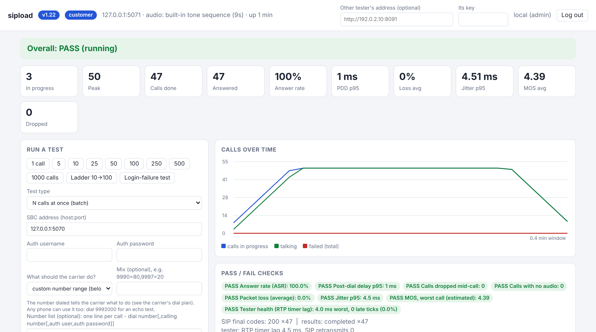

<h1 align="center">sipload</h1>
<p align="center"><b>SIP / RTP call load and fault tester for SBCs and softswitches</b><br>
Real G.711 audio · carrier + customer roles · live web dashboard · rated reports · Prometheus metrics</p>
<p align="center">


</p>



sipload is a single-file, standard-library-only Python tool built for testing the [Yeti Switch](https://yeti-switch.org/) but usable against any SIP
platform. One side (the **carrier**) answers calls and behaves according to the number dialed; the other (the **customer**) places them through your
SBC and grades what comes back: answer rate, post-dial delay, loss, jitter, MOS, dropped calls, audio presence and tone accuracy.

## Features
- **Real audio**, not just signalling: G.711 PCMU/PCMA with listen-live and recorded playback; other codecs for negotiation and transcoding load
- **Two roles in one file**: `carrier` (answers, injects faults) and `customer` (places calls, reports)
- **Web dashboard** (default `127.0.0.1:8090`): presets from 1 to 1000 calls, ladder tests, login-failure test, live charts, pass/fail checks
- **Fault injection by dial plan**: busy, 404, 503, no answer, no audio, packet loss, delay, echo
- **Alarm-panel (Contact ID) and DTMF tests**, caller-info readback with optional keypad password
- **Reports** saved automatically as HTML (charts), CSV and JSON; file names end in `PASS` or `FAIL`
- **Prometheus** `/metrics`, optional digest auth, dashboard logins, peer key between testers
- **Zero dependencies**: Python 3.8+ on Linux or Windows

## Quick start
```bash
python3 sipload.py selftest          # carrier + customer on this machine, prints a rated report

# on the machine behind your SBC
python3 sipload.py carrier
# on the calling side (dashboard at http://127.0.0.1:8090/)
python3 sipload.py customer
# or run headless
python3 sipload.py customer --run --target sbc.example.com:5060
```
Windows users: unzip, then double-click `start-customer-tester.bat` (see `README-windows.txt`).

## Dial plan
The number dialed tells the carrier what to do.

| Prefix | Behaviour | Prefix | Behaviour |
|---|---|---|---|
| `9989` | caller-info readback (optional keypad password via `--readback-password`) | `9994` | never answers |
| `9980`-`9982` | Contact ID alarm handshake (valid, no handshake, no kiss-off) | `9995` | answers, sends no audio |
| `9990` | tone sequence (scored by the tone test) | `9996` | packet loss |
| `9991` | speech | `9997` | 486 Busy |
| `9992` | echo | `9998` | 404 Not Found |
| `9993` | delayed answer | `9999` | 503 Service Unavailable |

## Reports and metrics
Reports land in `sipload-reports/` next to the script (change with `--out`). The dashboard lists them under **Saved reports**.

## Safety
Only test systems you own or are authorised to test. The dashboard binds to loopback by default; if you expose it, enable logins
(`python3 sipload.py user --help`) and put it behind TLS. See [SECURITY.md](SECURITY.md).

## Contributing and license
See [CONTRIBUTING.md](CONTRIBUTING.md). Licensed under [Apache-2.0](LICENSE); audio attribution in [NOTICE](NOTICE).
